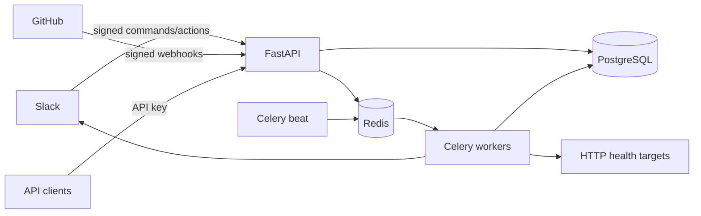

# Architecture

OpsPilot separates synchronous validation from asynchronous side effects. FastAPI authenticates API and webhook requests, PostgreSQL stores authoritative state and immutable incident events, Redis brokers Celery work and coordinates monitor locks, and workers process monitoring and GitHub deliveries. Slack is the operator interface; the REST API remains a complete local fallback.

The API returns quickly after validating and durably recording GitHub deliveries. Celery performs workflow processing with bounded exponential backoff. Health checks use short timeouts, a per-service Redis lock, state-transition detection, and a database query for an existing active monitoring incident. Recovery adds a timeline event but deliberately requires a human to resolve the incident.

Incident mutations lock the selected row in PostgreSQL. A centralized transition map rejects invalid state changes. Each mutation and automated recovery creates an `IncidentEvent`, providing a searchable audit trail independent of the current row.

Slack request authentication uses HMAC-SHA256 over Slack's `v0:timestamp:body` base string and rejects timestamps older than five minutes. GitHub requests use constant-time verification of `X-Hub-Signature-256`. Unique provider/delivery IDs make webhook ingestion idempotent.
